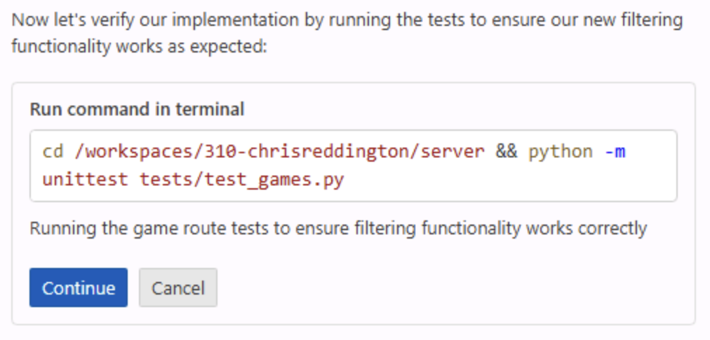

アプリケーションの簡単な更新でも、通常は複数のファイルを変更し、テストを実行するなどの作業が必要です。開発者は、必要なファイルを探し、変更を加え、テストを実行し、問題をデバッグして、変更漏れのあったファイルを見つけ、さらに修正することになります。作業は次々と続きます。

このようなときに Copilot Agent Mode が役立ちます。

Copilot Agent Mode は、IDE 内でより自律的に作業するよう設計されています。開発者のように既存のプロジェクト構成を調べ、必要な変更を行い、テストなどのタスクを実行して、見つかった問題を自動的に修正します。Agent Mode を使ってサイトに機能を追加する方法を確認しましょう。

> [!NOTE]
> 名前は似ていますが、agent mode と cloud agent は異なる利用方法を想定しています。Agent mode は IDE 内でタスクを実行し、すばやいフィードバックと対話を可能にします。Cloud agent は issue とプル リクエストを通じてやり取りし、チームの一員のように非同期で作業します。

この演習では、次のことを学びます。

- Copilot Agent Mode がプロジェクトを調べ、関連ファイルを特定して、複数ファイルにわたる変更を調整する方法。
- GitHub Copilot Agent Mode が UI とデータ レイヤーの両方にわたって機能を実装する方法。
- コードベースにマージする前に、Copilot Agent Mode が生成した変更とテストをレビューする方法。

## シナリオ

ゲームの一覧が増えてきたため、カテゴリとパブリッシャーで絞り込めるようにします。前の演習で publishers helper を追加しました。次は、Copilot Agent Mode を使って残りのデータ レイヤー、UI、テストを実装します。

## Tailspin Toys Web サイトを起動する

変更を加える前に、Tailspin Toys Web サイトを確認し、現在の機能を把握しましょう。

Web サイトは、開発者をテーマにしたボード ゲームのクラウドファンディング プラットフォームです。ゲームを一覧表示し、詳細を確認できます。単一の Astro アプリであり、ビルド時にページを静的 HTML として生成します。ページは Drizzle ORM を使って frontmatter からローカルの SQLite データベースを直接参照します。別のバックエンド API やクライアント側 UI framework はありません。再利用可能なデータ アクセス helper は `src/lib/` にあり、インタラクティブな機能は標準 DOM API を使った小さな Astro `<script>` で追加します。

### Web サイトを起動する

Astro 開発サーバーを起動する `npm run dev` タスクが用意されています。GitHub Codespace で次の手順を実行します。

1. Codespace に戻ります。前の演習を終えて `main` に戻っているはずです。
2. Codespace 内で新しいターミナルを開きます。<kbd>Control</kbd>+<kbd>\`</kbd> (Mac) または <kbd>Ctrl</kbd>+<kbd>\`</kbd> (Windows/Linux) を押します。
3. フィルター機能用の新しいブランチを作成して切り替えます。

   ```bash
   git checkout main
   git pull
   git checkout -b filtering-vscode
   ```

4. 次のコマンドを実行し、Web サイトを起動します。

   ```bash
   npm run dev
   ```

   Astro 開発サーバーが起動すると、次のような URL が表示されます。

   ```bash
   🚀 Tailspin Toys is ready!
      Astro server: http://localhost:4321
      Press Ctrl-C to stop.
   ```

> [!NOTE]
> `http://localhost:4321` を開くよう促すダイアログが表示された場合は、**x** を選択して閉じます。

5. ターミナルに表示された Astro サーバーのアドレス `http://localhost:4321` を、<kbd>Command</kbd> (Mac) または <kbd>Ctrl</kbd> (Windows/Linux) を押しながら選択して Web サイトを開きます。

> [!NOTE]
> Codespace のターミナルから localhost URL のリンクを選択すると、`https://<your-codespace-name>-4321.app.github.dev/` に自動的に転送されます。これは、Web サーバーをホストしている Codespace へのプライベート トンネルです。

### Web サイトを確認する

Web サイトを起動したら、現在の機能を確認します。主なページは次のとおりです。

- **Home Page**: ボード ゲームのタイトル、画像、説明を一覧表示します。
- **Game Details Page**: ゲームを選択すると、タイトル、説明、パブリッシャー、カテゴリなどの詳細ページが表示されます。

## Copilot でバックログを確認する

> [!TIP]
> **Copilot Chat を開く**
>
> 以下の演習を始める前に Codespace に戻り、Copilot Chat パネルを開き、**New Chat** を選択して新しい会話を始めます。モードとモデルの選択は演習ごとに異なります。必要な場合は、各手順で指定します。

Web サイトの初期実装は動作しますが、さらに機能を追加します。まずバックログを確認しましょう。テンプレートからプロジェクトを作成したときに、issue のバックログも自動的に作成されています。GitHub Copilot に内容を表示するよう依頼します。

1. Chat ビューの agents dropdown から **Agent** を選択します。Agent は複数ファイルにわたる変更を自律的に計画・実装し、ターミナル コマンドやツールを実行できます。

   

2. 使用可能なモデルの一覧から **Claude Sonnet 4.5** を選択します。

> [!CAUTION]
> このワークショップの作成者が、特定のモデルを推奨しているわけではありません。ワークショップの作成に Claude Sonnet 4.5 を使ったため、手順にも記載しています。提案の一貫性を高め、学習を進めやすくすることを目的としています。ただし LLM は確率的に動作するため、提案は手順の例と異なる場合があります。これは通常の動作です。

> [!NOTE]
> LLM の確率的な性質により、Copilot が異なる MCP コマンドを使う場合がありますが、タスクは実行できます。

3. 次のプロンプトを Copilot に送信し、issue のバックログを確認します。

   ```plaintext
   Please show me the backlog of items from my GitHub repository. Help me prioritize them based on those which will be most useful to the user.
   ```

4. **Continue** を選択して、すべての issue を一覧表示するコマンドを実行します。
5. 生成された issue の一覧を確認します。

Copilot が、ユーザーに最も役立つと考える順に issue を優先順位付けしたことを確認します。

## Instruction file を確認する

Agent にコードを生成させる前に、作業のコンテキストを Copilot に与える instruction file を確認します。ここでは、Web サイトの機能追加方法を説明する [user interface (UI)][ui-instructions] file を使います。

1. Codespace で `.github/instructions/ui.instructions.md` を開きます。
2. 機能追加に関する全体的なガイダンスを確認します。次の内容が含まれています。
   - アーキテクチャの概要。
   - コンポーネントの設計、テスト可能性、アクセシビリティの原則。
   - Astro、Tailwind CSS、Drizzle などのファイル種別に応じた instruction file へのリンク。

> [!TIP]
> Instruction file から、他の instruction file やプロジェクト内のファイルを参照できます。パスは instruction file の場所からの相対パスです。これにより、再利用や大きな instruction の分割、Copilot が参考にできる例やテンプレートの提示ができます。

[ui-instructions]: https://github.com/github-samples/tailspin-toys/blob/main/.github/instructions/ui.instructions.md

## フィルター機能を実装する

フィルター機能を完成させるには、アプリケーションに少なくとも 3 つの変更が必要です。

- データ レイヤー (`src/lib/`) にフィルター ロジックを追加または調整します。
- フィルターの動作を確認するテストを追加または更新します。
- ゲーム一覧ページにフィルター UI を追加します。

さらに、コードベースにマージする前にテストを実行し、成功することを確認します。Copilot Agent Mode にこれらの作業を依頼しましょう。

1. Copilot との現在の会話を続けるか、**New Chat** を選択して新しい会話を始めます。
2. **Add Context**、**Instructions**、**ui** を選択して instruction file を追加します。

   

3. Chat ビューの agents dropdown で **Agent** が選択されていることを確認します。

   

4. モデルとして **Claude Sonnet 4.5** が選択されていることを確認します。
5. バックログの関連 issue に基づいて機能を実装するよう、次のプロンプトを Copilot に送信します。

   ```plaintext
   Please update the site to include filtering by publisher and category based on the requirements from the related GitHub issue in the backlog. A publishers helper already exists from the previous exercise, so preserve and refine that work as needed while completing the remaining data-layer, UI, and tests. Ensure all tests are passing before completion. The server is already running, so you do not need to start it up.
   ```

6. Copilot がプロジェクトを調べ、機能に関連するファイルを見つける様子を確認します。データ レイヤー helper、UI、テストを特定して変更し、テストを実行します。

   

> [!NOTE]
> Copilot はプロジェクトの調査、変更、テストなど複数のタスクを実行します。タスクやコードベースの複雑さによって、数分かかる場合があります。作業中、コード エディターに **Keep** と **Undo** が表示されることがあります。Copilot が完了すると、すべての変更に対して **Keep** または **Undo** が表示されるため、作業中に選択する必要はありません。

7. Copilot に促されたら **Continue** を選択してテストを実行します。

   

8. 作業中に一時停止したり、テストが失敗したりする場合があります。問題ありません。Copilot はコード生成とテストを繰り返し、タスクが完了してエラーがないと判断するまで作業します。

   

9. 生成されたコードに問題がないか確認します。

> [!CAUTION]
> Copilot などの AI ツールが生成したコードは、必ずレビューしてください。

10. Web サイトを起動しているブラウザーに戻り、新機能を試します。
11. 動作を確認してコードをレビューしたら、Copilot Chat ウィンドウで **Keep** を選択します。

## まとめと次のステップ

この演習では、GitHub Copilot Agent Mode を使って Tailspin Toys Web サイトに機能を追加する方法を確認しました。次のことを学びました。

- GitHub Copilot Agent Mode で UI とデータ レイヤーの両方にわたる機能を実装できます。
- Copilot Agent Mode でプロジェクトを調べ、関連ファイルを特定し、複数ファイルの変更を調整できます。
- コードベースにマージする前に、Copilot Agent Mode が生成した変更とテストをレビューします。

次は [Playwright MCP サーバーで機能をテストし][next-lesson]、プル リクエストを作成します。

### ボーナスの演習 — ページ分割を実装する

ゲーム一覧が増えたら、ページ分割が必要になります。この演習で学んだ方法を使い、Copilot にページ分割の実装を依頼します。次の点を検討してください。

- 既存の instruction file を使うなど、現在のベスト プラクティスに従います。
- ページ サイズをユーザーが選べるようにするか、固定にするかを検討します。
- 希望する実装に必要なガイダンスを、Copilot へのプロンプトに含めます。
- Copilot に変更を依頼し、コンテキストを伝えながら何度か改善する場合があります。これが Copilot を使う通常のワークフローです。

## リソース

- [Copilot の ask、edit、agent mode: 機能と使い分け][choose-mode]
- [VS Code の agent mode][vs-code-agent-mode]

[previous-lesson]: ../1-custom-instructions/
[next-lesson]: ../3-mcp/
[choose-mode]: https://github.blog/ai-and-ml/github-copilot/copilot-ask-edit-and-agent-modes-what-they-do-and-when-to-use-them/
[vs-code-agent-mode]: https://code.visualstudio.com/docs/copilot/chat/chat-agent-mode
